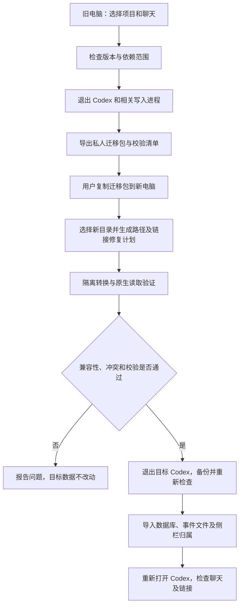

# Windows / macOS Codex 迁移框架设计

日期：2026-10-27，2026-10-28 补记 alpha 实现状态。本文为设计基线，不是稳定支持声明。当前代码已实现选择性导出、规划、链接修复及离线恢复；实际 API 见[实现契约](../../implementation-contract.md)，用户命令见[使用指南](../../usage.md)。

**当前实现与原设计的取舍：** alpha 采用完整目标数据库快照，在隔离副本中合并行，再以目标文件原摘要为条件逐文件发布（CAS）并记录恢复日志；不在正式目标执行下文早期设计中的附加库事务。没有跨文件整体原子性。仅接受 `native-state5-history1-61-8-alpha` 精确结构配置；每数据库结构化规划上限 256 MiB。Windows 桌面原生闭环仍待验收。

## 1. 目标和可行性结论

把一次已经成功的 Windows → Mac 本地迁移，整理为其他用户可以安装、检查、执行及恢复的开源工具。迁移对象是本地项目文件、项目归属、原生聊天及其历史依赖和附件。

结论是**有条件可行**：已有实际迁移证明核心读写与索引转换可以工作；但通用导出器、Windows 导入端、历史正文中的链接修复及来回交接仍须开发和验证。不能把一次成功推广为任意版本、任意文件系统都能无风险运行。

成功必须分别回答：文件是否复制且校验一致；聊天是否能在原生 Codex 打开；项目归属是否正确；已打包文件的历史链接是否可用；目标原有数据是否保留。文件计数正确不能替代其余四项。

## 2. 方案选择

| 方案 | 收益 | 问题 | 建议 |
| --- | --- | --- | --- |
| 直接复制整个 Codex 数据目录 | 实现短 | 路径、登录状态、数据库日志、目标已有数据及侧栏缓存会相互影响 | 排除 |
| Python 核心＋受支持版本适配器＋双击向导 | 算法可测试、审查和复用；两平台共享大部分代码 | 仍需单独实现平台文件操作及打包 | 推荐作为第一阶段 |
| 完整图形应用 | 对初学者友好 | 不降低迁移底层风险，增加打包、签名和 UI 维护 | 核心稳定后再考虑 |

Python 源码版建议以 3.11 为最低版本；标准库负责 JSON、SQLite、ZIP64、哈希和基本 CLI。Markdown 链接的精确解析需单独选型和验证，不能以脆弱的全局正则代替。打包版可内置运行时；源码版与双击脚本不能伪称“完全不需要安装环境”。

## 3. 范围与版本路线

### 第一阶段：受限版本下的双向搬家

- 自动识别系统、有效 Codex 数据位置和已安装的 CLI；支持显式覆盖位置。
- 列出本地项目及未归属项目的聊天，由用户选择范围；归档聊天可明确选择。
- 导出所选聊天的依赖闭包：必须包含被引用的祖先、继承历史和必要子会话。预览额外纳入的范围，不能默默把无关聊天带入。
- 普通项目目录、已明确包含的附件、原生聊天、侧栏项目及归属迁移。
- 单独的只读预检、隔离演练、增量导入、恢复日志和重启后检查。
- 包内文件链接可验证修复，保留修复前原始聊天。
- 相同 ID 若已有内容差异则停止；同名项目不自动合并。

导出依赖闭包限定在新建迁移副本需要读取的对象上：从用户选中的主聊天出发，加入其明确引用的祖先、继承边界和子代理对象，再递归加入这些依赖所需对象。仅因某个未选聊天也继承同一个祖先，不把它带入包。例如选中 A，A 继承 P，B 也继承 P：只因这个关系应导出 A 和 P，不导出 B。源端 P 不会被修改；新目标中的 P 只需服务包内引用。若协议要求的依赖无法完整表示，停止该范围导出，不截断身份关系。

原地链接修复的闭包则在目标现存的完整历史依赖图中计算反向依赖：某个文件字节布局改变后，所有引用它边界的后继都必须纳入，再递归传播。两类闭包不能共用“从祖先收集全部子孙”的规则。用户拒绝纳入必需对象时，取消这批原生迁移/修复，可另选范围或仅导出只读文件。

第一阶段先发布开发预览，再在两个平台分别通过真机验收后宣布“双向可用”。Windows 导出成功并不能代替 Windows 导入成功。

### 第二阶段：有共同基线的来回交接

例如 Windows 导出到 Mac，用户只在 Mac 续聊，之后迁回原 Windows。导出和导入收据必须保存同一逻辑聊天的基线摘要、适配器版本、路径规范化规则及迁移谱系。

仅在“目标仍等于已知基线、来源是可证明的受支持延续”时允许交接更新；两边均修改、缺少基线、出现无法解释的压缩/分叉或历史重写时，停止并展示差异。不得把时间更新较晚的一份直接覆盖另一份，也不得随意改线程 ID 伪装成无冲突。

第一阶段的重复导入只对同一迁移收据严格幂等；没有收据的同 ID 内容即使看似一致，也先报告碰撞，避免错误认定同源。

### 不在首版内

云端 ChatGPT 历史同步、浏览器和插件登录迁移、软件与 Python/Node/SPSS 等运行环境安装、两台电脑并行续聊的自动合并、远程任务/多主机交接、未支持的 Git worktree 和 WSL 数据目录混合迁移。

普通 Git 仓库可设计为显式的“文件＋完整自包含 .git”模式，但须额外验证仓库是否真的自包含。首版默认项目文件快照；若未包含 .git，界面和清单必须明确写“未迁移 Git 历史”。Git worktree、submodule 外部 gitdir、alternates 和外部符号链接不得作为普通文件夹静默复制。

## 4. 对用户的流程



独立向导在终端或打包应用中运行；不依靠正在被关闭的 Codex 聊天进程继续执行。无需让初学者编辑 SQLite 或学习 Git。默认不自动关闭或强杀 Codex，也不发起模型对话、执行项目命令或自动运行仓库脚本。

若用户已完成迁移后才发现 E: 盘链接失效，可运行 alpha 的 `repair-links` 规划流程：扫描指定聊天 → 指定旧根与现有新根 → 验证实际文件 → 预览链接差异 → 退出 Codex → 备份并修复 → 重建相关偏移 → 重启验证。它不要求重新复制已核对一致的项目目录。

## 5. 设计时的模块分工

以下树为最初分层草图，不是当前目录清单。alpha 将导入/恢复整合在 `operations.py`、`staging.py`、`transaction.py`，将平台函数放在 `platforms.py`，原生验证放在 `native_verify.py`；没有独立的 models/importer/recovery/receipts 模块。仓库名称为 `codex-migrate-windows-mac`。

```text
codex-migrate-windows-mac/
├── README.md / README.en.md
├── LICENSE                         # 已采用 MIT
├── pyproject.toml
├── src/codex_migrate/
│   ├── cli.py                      # 命令参数、退出码、JSON 报告
│   ├── wizard.py                   # 中文/英文交互流程
│   ├── models.py                   # Inventory、Plan、Receipt
│   ├── discovery.py                # 显式路径/环境/配置位置解析
│   ├── compatibility.py            # 适配器和兼容性门槛
│   ├── export.py                   # 选择、依赖闭包、干净导出
│   ├── bundle.py                   # 流式包读写、清单与资源限制
│   ├── paths.py                    # Win/POSIX 路径语义和碰撞
│   ├── links.py                    # 历史文件引用发现与精确修复
│   ├── history.py                  # 事件转换、继承依赖与偏移重建
│   ├── staging.py                  # 隔离目标构建与演练
│   ├── importer.py                 # 只增量导入和事务控制
│   ├── recovery.py                 # 提交日志、补完与恢复预检
│   ├── verify.py                   # 数据、原生分页、重启验证
│   ├── receipts.py                 # 幂等收据与未来交接基线
│   ├── adapters/                   # 每个受支持格式的显式实现
│   └── platforms/
│       ├── base.py                 # 平台操作契约
│       ├── macos.py
│       └── windows.py
├── launchers/                      # Windows .cmd / macOS .command
├── tests/
│   ├── fixtures/synthetic/         # 全部为人工生成数据
│   ├── unit/
│   ├── integration/
│   ├── crash_recovery/
│   └── platform/
├── docs/                           # 安装、双向教程、原理、排错
└── .github/
    ├── workflows/                  # 双系统测试、构建和发布
    └── ISSUE_TEMPLATE/             # 不要求上传真实聊天或迁移包
```

## 6. 模块接口与数据契约

以下为设计签名；当前 alpha 的准确函数签名与副作用以[实现契约](../../implementation-contract.md)为准，不应按本表直接调用。

| 接口 | 输入 | 输出和副作用 |
| --- | --- | --- |
| `inspect(layout) -> Inventory` | 明确的 CodexHome 与 SQLiteHome | 版本、格式、项目、线程数量及支持程度；只读 |
| `export(inventory, selection, output) -> BundleInfo` | 已确认的导出范围 | 新建私有包及校验清单；不修改原聊天 |
| `plan_import(bundle, target, destinations) -> MigrationPlan` | 源包、目标、目录选择 | 路径、链接、冲突、空间、动作预览；不写目标 |
| `plan_link_repair(target, scope, mappings) -> MigrationPlan` | 已迁入聊天、显式旧新路径 | 无文件重复制的离线修复计划 |
| `stage(plan, directory) -> StageReport` | 冻结计划与包 | 隔离转换、校验结果、最终文件摘要 |
| `apply(plan, stage) -> Receipt` | 已验证且仍有效的计划 | 备份、事务导入/已授权修复、持久化收据 |
| `recover(receipt_or_journal) -> RecoveryReport` | 日志及当前目标 | 补完或拒绝；不无条件覆盖后续用户改动 |
| `verify(receipt, mode) -> VerificationReport` | 导入收据 | 分层验证；原生读取不得发送新的模型任务 |

`MigrationPlan` 必须绑定：bundle 摘要、选择范围、目标位置、源/目标兼容配置、旧新路径表、原目标指纹、链接修改清单、预计新增/修改行、磁盘空间估计和阻塞问题。计划生成后用户继续使用目标 Codex，正式写入前应重新核对并重新规划。

`Receipt` 记录工具版本、适配器、迁移 ID、阶段、源包摘要、前后对象摘要、所拥有文件的标识、备份位置、允许的字段变更及验证结果。日志默认不记录聊天正文或凭据。

## 7. 数据位置与兼容适配器

不能只拼接用户名和 `.codex`。Codex 支持 `CODEX_HOME`、`CODEX_SQLITE_HOME`，SQLite 位置还可能被配置覆盖；Windows 原生与 WSL 的数据位置也可能不同。显式参数优先，其余按目标应用的实际配置解析并向用户展示；无法确定时要求用户选择位置，不扫描整台磁盘寻找聊天。[官方环境变量说明](https://learn.chatgpt.com/docs/config-file/environment-variables)、[Windows 说明](https://learn.chatgpt.com/docs/app/windows)。

解析配置仅获取位置所需字段，不将原配置复制进导出包。不展开执行配置命令，也不自动加载源端插件、MCP、自动化或项目环境。

每个格式适配器必须明确验证：

1. 数据库迁移记录、表/列/类型/主键、FK、索引和相关触发器。
2. rollout 事件、ordinal、history_base 和 item JSON 的语义。
3. 桌面项目缓存与项目成员归属的布局。
4. 源/目标 CLI 及 app-server 必需能力、已经实测的版本组合。
5. 目标系统上路径、图片和 Markdown 文件链接的渲染格式。

匹配策略不是“列名相同即可”。未知表中的迁移依赖、未知权限格式、无法识别的事件/偏移语义都必须拒绝原生写入；可另行提供文件或只读聊天导出，但不能显示为原生迁移成功。兼容规则随发布更新，不自动从网上下载并执行适配器。

当前 macOS 合成原生验证使用 CLI `0.164.0-alpha.11.1`，结果与限制见[验证记录](../../validation.md)。该构建证据不等于覆盖 Windows 桌面或所有版本的支持矩阵。

## 8. 私人迁移包

建议新格式采用 ZIP64＋DEFLATE，流式处理大文件，避免依赖用户额外安装 zstd。旧的一次性 tar.xz/JSONL.zst 包不是新格式；兼容旧包若有需要，另做显式 legacy 适配器。

```text
manifest.json                  # 格式版本、来源平台、适配器及文件摘要
selection.json                 # 所选项目/聊天与额外依赖范围
data/state/*.jsonl             # 适配器允许的业务行，BLOB 显式编码
data/history/*.jsonl
events/<opaque-id>.jsonl        # 原始事件序列
projects/<root-id>/...          # 包内相对路径
assets/<asset-id>/...           # 明确纳入的本地附件
maps/roots.json                # 原路径、稳定 root-id、包内位置
maps/references.json           # 已识别引用及文件摘要
```

清单摘要验证文件完整性；不证明包可信。解包必须限制文件数量、单文件/总展开大小、压缩率和 JSON 记录尺寸，并拒绝路径穿越、绝对路径写入、设备路径、大小写/Unicode 等价碰撞、链接越界及 ZIP 重复成员。包中 SQL 结构只作为比对信息，不能直接执行外来 DDL、触发器或脚本。

不复制源原生数据库整文件到选择性导出包，以免带出未选行或 SQLite 空闲页中的旧信息；新建干净容器，只导出已确定的业务行。登录凭据、钥匙串、浏览器会话、完整应用全局状态及环境变量不导出。项目 `.env` 等常见秘密文件默认列入排除预览；秘密也可能存在于任意代码、Git 历史或聊天，工具不承诺全面脱敏。

恢复备份和迁移包是不同对象：恢复备份仅留在目标本机；用户迁移包只供本人私下转移；公开仓库和 CI 不接收任何真实用户数据。

## 9. 路径、历史链接和附件

完整细节见[历史链接修复方案](../../history-link-repair.md)。这是首版正式验收项，不能仅修复 cwd 后宣称历史文件引用已恢复。

路径以来源平台语义解析，不能让 macOS 的 `Path` 把 `E:\\...` 当普通相对文件名。采用显式根映射、最长路径段匹配和目标约束检查；同根多项目共享文件只存一份，多目录项目保留根集合。文件名碰撞、Mac 上合法但 Windows 不允许的名称及过长路径须在写入前列出并阻塞相关范围；不自行改名后留下失效链接。

文件链接按结构分为：原生附件对象、可明确解析的 Markdown 链接目标、可明确识别的文件引用块、纯文字路径。前三者由适配器识别并生成精确补丁；纯文字及代码中的示例路径不全局替换。图片的结构化 `savedPath` 等字段也须同时处理。

只有清单或用户显式选择的映射，且实际目标文件存在并通过相应内容核验，才能生成自动补丁。不能靠“同名文件”猜测，也不能自动读取聊天文本提到的任意外部路径。缺失文件、映射歧义和解析不支持分别报告。

保留原始事件/正文于私人原包及修复前备份。工作副本只修改审核过的链接目标或明确的附件路径；因此不能再声称“所有消息字节完全不变”。正确校验是：可见叙述文字、链接标签、代码块和非链接内容保持一致；差异只来自清单允许的位置。每个补丁保留 thread/turn/item 标识、前后摘要、字段位置和理由。

## 10. 历史转换和索引

必须先完成所有结构路径、权限和历史链接转换，再计算最终 UTF-8 JSONL 字节位置。序号 `ordinal` 是身份，不等于行号，不允许排序或重新编号。

- turn 起始 offset 指向其 ordinal 的行首，结束 offset 指向包含式结束 ordinal 的行尾。
- projection offset 指向其 next ordinal 的正确边界，不能一律改成 EOF。
- `history_base.end_ordinal_exclusive` 指向祖先历史的排他边界；需按真正的字节依赖拓扑处理，保留 parent/fork/spawn 等身份。
- 同文件历史引用必须仅指向已经完成的前缀；循环、缺失祖先和未知边界语义拒绝转换。
- 链接修复只转换显式选择及受影响后继；所需祖先以原字节提供上下文，不因祖先被读取而扩入无关兄弟聊天。父事件文件长度改变时，所有引用该历史边界的后继都需纳入计划。
- rollout 和 `thread_items.item_json` 等展示投影同步更新，不能只改 HTML 导出或只改一个数据库表。

转换后的权限按目标本机策略重新落地，不复制旧设备不适用的目录授权，也不自动开启 full access 或静默批准。所有权限变化单独列在计划中；未知策略格式阻塞原生导入。

## 11. 离线提交、备份与恢复

旧实现的 `fcntl`、`lsof`、固定 `ps` 路径、目录 `fsync`、inode/硬链接逻辑不得原样宣称为 Windows 可用。平台层提供进程/占用探测、锁、刷新、不覆盖发布与文件所有权验证。

macOS 和 Windows 都要求源/目标应用及相关写入者退出；数据库锁不能替代 GUI 检查，GUI 退出也不能替代数据库检查。Windows 需验证原生文件句柄共享模式等行为，权限不足时停止。自建迁移锁只能协调本工具，不能保证阻止 Codex 被用户重新启动；写入前后须重复检查并比较目标指纹。[Windows 文件打开语义](https://learn.microsoft.com/en-us/windows/win32/api/fileapi/nf-fileapi-createfilew)、[文件锁限制](https://learn.microsoft.com/en-us/windows/win32/fileio/locking-and-unlocking-byte-ranges-in-files)。

首版原生导入限制在已测试的本地文件系统与明确的数据布局；网络盘、同步占位文件或无法可靠判断发布/刷新语义的位置不允许写入。迁移包可以经移动磁盘转移，正式暂存、备份和导入在受支持的本地磁盘执行。

写入顺序：

1. 验证包与冻结的 stage；确认源、目标兼容配置仍一致。
2. 确认空闲，使用 SQLite backup 得到一致快照，备份相关 JSON/index 和将修改的事件文件，校验可读性。
3. 将新文件放入目标同卷隐藏暂存区，刷新并记录摘要；拒绝路径及 ID 碰撞。
4. 在隔离副本内合并允许行、重建历史偏移并做完整性检查；当前 alpha 不在正式目标开启附加库写入事务。
5. 当前 alpha 在暂存数据库完成合并和完整性检查后，准备完整文件发布清单，逐文件以计划记录的原摘要为比较条件发布。项目、事件、整份数据库、旁文件和 JSON 的每项前后摘要、备份及状态持久化记录；中断时仅在所有现存对象仍符合已记录前/后状态时恢复，保持下述停机窗口。
6. 按发布清单处理暂存数据库、侧栏全局状态及索引；源全局状态绝不整份覆盖目标，目标备份只在私人暂存与恢复目录中保留。每个边界均持久化日志。
7. 校验并写收据，恢复已验证的正常运行状态，然后允许用户打开 Codex。

数据库、事件文件及 JSON 不存在一个天然的整体事务。SQLite WAL 模式不能保证多附加库整体的崩溃原子性，数据库之外仍需要持久化日志和恢复状态机。[SQLite ATTACH](https://www.sqlite.org/lang_attach.html)、[SQLite WAL](https://www.sqlite.org/wal.html)。

**保证成立的前提是维持停机窗口。** 从首次目标写入到验证完成，用户不得打开 Codex；工具异常退出或电脑重启后，必须先重新运行迁移工具的恢复入口，得到明确完成结果后才能启动 Codex。首版不实现系统级禁止启动机制，也不承诺能在工具已崩溃时主动拦截 Codex。界面、错误信息和发布文档必须明确这一前提，不可写成“任意时刻开机打开都自动安全”。

若中断后 Codex 已被启动或任一目标对象出现计划外变更，先要求再次退出并保存当前数据库、事件、索引和日志的独立快照；停止自动补完和旧备份覆盖，输出差异及人工恢复计划。不能仅凭进程现在已退出就证明中断期间未发生读写。针对“中断后误启动”的测试，验收目标是保全现状并拒绝危险覆盖，而不是声称没有发生任何损害。

恢复区分：提交前撤销本工具创建的对象；数据库已提交但 JSON 未发布时安全补完；用户已继续聊天/移动项目/编辑文件时拒绝直接覆盖，先保全新变化再生成恢复计划。“有备份”不等于“可随时恢复且不丢后续工作”。

原有项目名称、设置和聊天保持；新增项目与同名项目可并存，通过提示区分。用户导入后主动合并项目属于正常后续变更，不应被重跑迁移撤销。

## 12. 验证与发行门槛

### 自动化测试

使用人工构造的数据，不使用本次真人聊天、附件或 UUID。测试必须覆盖双向路径、中文/空格/括号、盘符与 UNC、共享根、文件名冲突、超长路径、缺失附件、多代历史继承、非零起始 ordinal、图片、链接修复、无关文字保护、重复导入和聊天分叉冲突。

故障注入覆盖磁盘不足、权限拒绝、文件被占用、每个提交阶段强制退出、数据库已提交但阶段日志尚未更新、索引发布失败、用户后来修改目标等情况。每例同时验证原有对象和恢复后的可读取性，而非只判断退出码。

使用 GitHub Actions 的 Windows 与 macOS runner 分别测试平台实现。合成数据和 CI 通过仍不等于桌面产品真机验收通过。[GitHub runner 文档](https://docs.github.com/en/actions/how-tos/write-workflows/choose-where-workflows-run/choose-the-runner-for-a-job)。

### 原生验收

至少在每个宣布支持的 OS/架构/版本组合上完成：导出 → 隔离验证 → 导入 → 重启 → 项目归属可见 → 所有选中聊天分页读取 → 默认继续原聊天 → 历史文件链接实际打开。原生验证使用所装 app-server 的能力，不发送模型任务；实际继续聊的闭环使用专门合成测试项目进行。

文件链接的文件存在性测试与原生窗口实际点击测试分别记录。仅有 shell 中 `exists()` 为真，不能宣布在 Codex 中点击已通过。

未完成 Windows 真机闭环前，不发布“Windows 导入稳定可用”；未完成既有原生聊天链接补丁验证前，不发布“历史链接全部自动修复”；未完成共同基线交接前，不发布“无缝来回切换”。

## 13. 分阶段交付

| 阶段 | 产物 | 进入下一阶段的条件 |
| --- | --- | --- |
| A：设计审查 | 本设计、风险表、链接修复方案 | 需求范围和主要技术选择确定 |
| B：可验证核心 | discovery、包格式、路径/链接/索引转换与合成测试 | 只读检查及隔离转换通过，不碰真实数据 |
| C：Mac 导入预览 | 泛化的 Mac 离线导入、恢复、双击入口 | Mac 真机含链接和故障恢复通过 |
| D：Windows 导入预览 | Windows 平台操作与对应发行包 | Windows 真机含链接和故障恢复通过 |
| E：双平台发布 | 中英文文档、许可证、CI、已验证兼容表和下载包 | 两个方向分别验收，公开仓库无个人数据 |
| F：来回交接 | 基线收据、受限延续判定与冲突报告 | 不同设备往返和分叉负例均通过 |

发布使用独立源码仓库；首次在 GitHub 发布时只提交经检查的代码与文档。不要把本次私人迁移文件夹作为仓库上传。具体操作见[GitHub 发布说明](../../github-publishing.md)。
